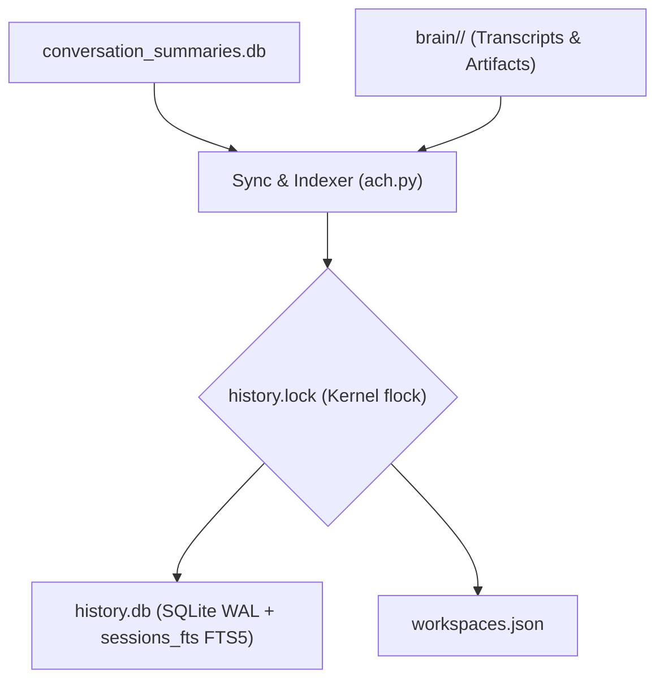
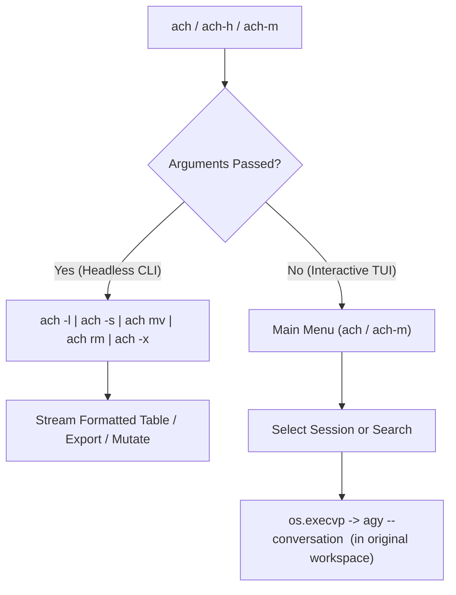
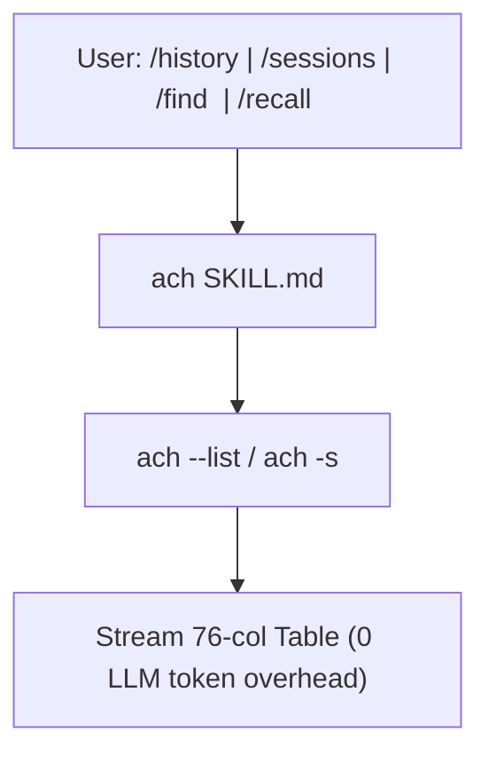

# Ach!

**Archive Chat History** — Unified session manager for Google Antigravity CLI (`ach`).

[](https://github.com/AshraArc/ach-cli/releases)
[](LICENSE)
[](#architecture--how-it-works)

`Ach!` (`ach`) provides SQLite FTS5 full-text search, 1-key interactive session resuming, workspace transplanting (`ach mv`), batch maintenance, Markdown export (`ach -x`), and zero-token in-chat conversational history recall.

---

## Highlights

- **Fast FTS5 Search**: Query complete conversation histories, titles, and notebooks in under 4ms using SQLite WAL mode (`sessions_fts`).
- **1-Key Resume**: Jump straight into active sessions via `os.execvp` into `agy --conversation <cid>` in the original workspace without copying 36-character UUIDs.
- **Workspace Transplanting (`ach mv`)**: Move single sessions or entire notebook groups to a new project directory.
- **Batch Cleanup**: Prune dead or test chats in bulk with ranges (`ach rm 1-3` / `d 1-3`) or lists (`ach -d 1,3,4` / `d 1,3,4`).
- **Markdown Export (`ach -x`)**: Export conversation transcripts to clean Markdown files in `.agents/exported_chats/`.
- **Zero-Token Fast Path**: In-chat `/history`, `/sessions`, `/find`, and `/recall` stream pre-formatted 76-column tables with zero LLM generation latency.
- **Concurrency Safe**: Advisory kernel locking (`history.lock` via `flock`) prevents race conditions across multi-terminal setups.

---

## Installation

### 1-Line Quick Install

```bash
curl -fsSL https://raw.githubusercontent.com/AshraArc/ach-cli/main/get.sh | bash
```

Custom binary prefix (e.g., `ag` instead of `ach`):

```bash
curl -fsSL https://raw.githubusercontent.com/AshraArc/ach-cli/main/get.sh | bash -s -- ag
```

By default, `get.sh` and `install.sh` install three launchers into `~/.local/bin/`:
- `ach`: Unified entry point (launches interactive TUI with no args, or runs headless CLI flags).
- `ach-h`: Fast non-interactive table dump (`--list` default, `< 90ms`).
- `ach-m`: Direct interactive terminal management dashboard.

### Antigravity In-Chat Plugin

To enable conversational session recall inside active Antigravity chats:

```bash
agy plugin install https://github.com/AshraArc/ach-cli
```

*Or install locally:* `agy plugin install /path/to/ach-cli`

---

## Architecture & How It Works

### 1. System Architecture & Storage



### 2. CLI & Interactive Execution



### 3. In-Chat Skill Fast-Path



---

## CLI Shortcuts, Flags & Examples

### Complete CLI Reference

| Flag / Command | Description | Example |
| :--- | :--- | :--- |
| `-h`, `--help` | Show POSIX-style help message | `ach --help` |
| `-v`, `--version` | Show version information | `ach -v` |
| `-l`, `--list` | Show 15 most recent chats (default for `ach-h`) | `ach -l` |
| `-a`, `--all`, `--list-all` | Show complete uncapped history | `ach -a` |
| `--days <N>` | Filter chats from the last `N` days | `ach --days 7` |
| `-H`, `--hours <N>` | Filter chats from the last `N` hours | `ach -H 2` |
| `-s`, `--search <query>` | Full-text search (FTS5) across titles, history, and notebooks | `ach -s "auth bug"` |
| `-x`, `--export <id\|all>` | Export session(s) directly to Markdown (`.md`) | `ach -x 1` |
| `-d`, `--delete`, `--del`, `rm <ids...>` | Delete session(s) non-interactively | `ach rm 1-3` |
| `mv <id\|num> [target_dir]` | Move/transplant chat to target directory (default: CWD) | `ach mv 2 ~/projects/api` |
| `mv -g`, `--group <name> [target_dir]` | Move all chats in a group to target directory | `ach mv -g backend ~/api` |
| `--groups-cli` | List all notebook groups | `ach --groups-cli` |
| `--set-title <id> "<title>"` | Set clean abstracted session title | `ach --set-title 1 "Fix FTS5"` |
| `--update` | Check and pull latest updates | `ach --update` |
| `--uninstall` | Uninstall Ach! and its shortcuts | `ach --uninstall` |

### Copy-Paste Examples & Sample Output

**List recent sessions (`ach -l` or `ach-h`):**
```bash
ach -l
```
```text
#   Time          Workspace          Title
1   Today 18:24   ach-cli            Investigate FTS5 full-text recall benchmark
2   Today 15:10   ach-cli            Build sqlite wal query pipeline & flock mutex
3   Yesterday     anti-g             Add multi-workspace transcript sync
```

**Full-text search (`ach -s "<query>"`):**
```bash
ach -s "sqlite wal"
```
```text
#   Time          Workspace          Title
1   Today 15:10   ach-cli            Build sqlite wal query pipeline & flock mutex
```

**Time-filtered history (`--days <N>` / `-H <N>`):**
```bash
ach --days 7
ach -H 2
```

**Export to Markdown (`ach -x <id|all>`):**
```bash
ach -x 1
ach -x all
```
```text
Exported session 1 -> .agents/exported_chats/2026-11-23_Investigate_FTS5_recall.md
```

**Transplant sessions or groups (`ach mv`):**
```bash
ach mv 2 ~/projects/api
ach mv -g backend ~/projects/api
```

**Batch delete (`ach rm` / `ach -d`):**
```bash
ach rm 1-3
ach -d 1,4,7
```

**Manage titles, groups, and lifecycle:**
```bash
ach --groups-cli
ach --set-title 1 "FTS5 Benchmark"
ach --update
ach --uninstall
```

---

## Interactive TUI Shortcuts (`ach` / `ach-m`)

Launch the keyboard-driven dashboard with `ach` or `ach-m`:

```text
Ach! v2.2.1
────────────────────────────────────────────────────────────
[1] Today 18:24  Investigate FTS5 full-text recall benchmark
[2] Today 15:10  Build sqlite wal query pipeline & flock mutex
[3] Yesterday    Add multi-workspace transcript sync
```

### Main Dashboard & All Chats
- `<num>`: Resume selected session immediately in its original workspace.
- `m <num>`: Move/transplant session `<num>` to another workspace directory.
- `e <num>`: Edit chat title or update group label.
- `x <num|all>`: Export session `<num>` (or `all`) to Markdown.
- `d <n1,n2..>` / `d 1-3`: Batch delete sessions by list or range (e.g. `d 1,3,4` or `d 1-3`).
- `n`: Launch a brand-new Antigravity session.
- `Esc` / `b`: Return to previous menu or cancel.

### Search & Resume
- Enter search mode from the Main Menu to query titles, transcripts, and notebooks via SQLite FTS5, then press `<num>` to resume.

### Groups & Notebooks
- View and filter sessions by notebook group; use `m <num>` to move/transplant a group or session.

### Settings (`[1]-[7]`)
- Configure display limits, default workspace behavior, sync/index preferences, and maintenance options directly from the Settings menu (`[1]`–`[7]`).

---

## In-Chat Conversational Usage

Inside any active Antigravity chat, trigger session history with slash commands or natural language:

| Goal | Slash Command / Natural Language Trigger |
| :--- | :--- |
| **Recent sessions** | `/history`, `/sessions`, or `"show my chat history"` |
| **Search transcripts** | `/find <query>`, `/recall <query>`, or `"search history for sqlite fts5"` |
| **Full archive** | `"show me all chat histories"` |
| **Time filter** | `"history of past 7 days"` or `"past 2 hours"` |
| **Notebook groups** | `"show my notebook groups"` |

---

## Directory Structure

```text
ach-cli/
├── ach.py                      # Core engine: SQLite WAL/FTS5 index, TUI, CLI, flock locking
├── get.sh                      # 1-line remote installer (default prefix: ach)
├── install.sh                  # Local installer (installs ach, ach-h, ach-m)
├── uninstall.sh                # Uninstaller script
├── plugin.json                 # Antigravity plugin manifest
├── README.md                   # Documentation & usage reference
├── v2.2.1.md                   # v2.2.1 release notes
└── skills/
    └── ach/
        └── SKILL.md            # In-chat agent skill definition
```

Runtime storage paths:
- `.agents/sessionlist_data/history.db`: SQLite WAL database + `sessions_fts` FTS5 index.
- `.agents/sessionlist_data/history.lock`: Kernel `flock` mutex for safe concurrent writes.
- `.agents/exported_chats/`: Destination for exported Markdown transcripts (`*.md`).
- `~/.local/bin/`: User launchers (`ach`, `ach-h`, `ach-m`).

---

## Uninstall

```bash
curl -fsSL https://raw.githubusercontent.com/AshraArc/ach-cli/main/uninstall.sh | bash
```

Or run `ach --uninstall` / `./uninstall.sh` from the repository root.

---

## License

[MIT](LICENSE) © [AshraArc](https://github.com/AshraArc)
