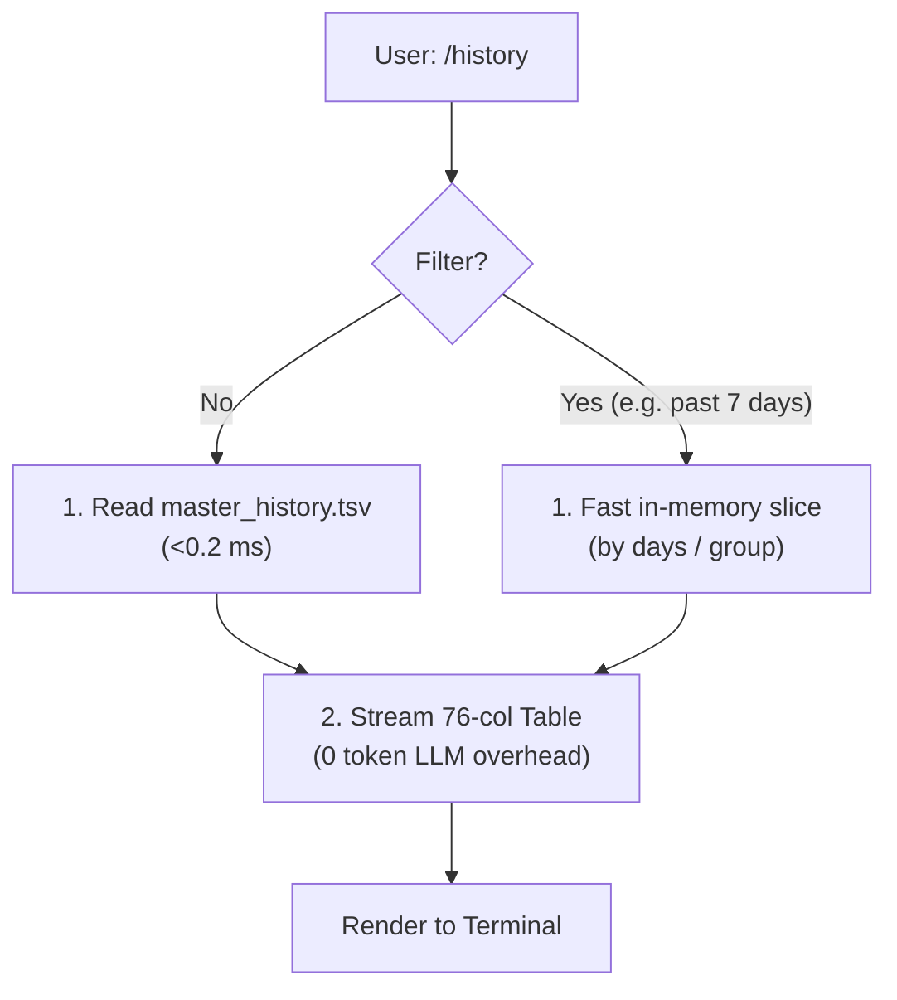
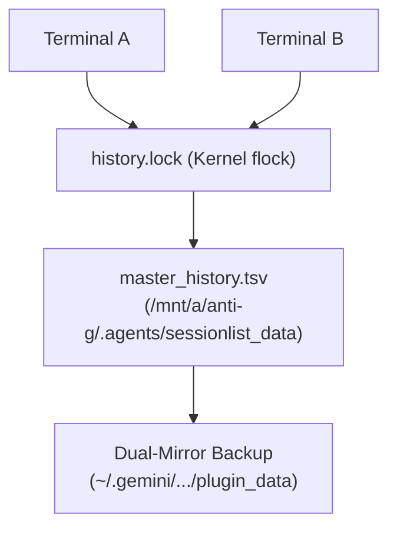

# sessionList

Unified session manager and history recall for **Google Antigravity CLI (`agy`)**.

Created by **AshraArc**.

Use **`sessionList`** across two environments:
1. **Terminal Interface**:
   - **`antig-h`**: Instant non-interactive session table list directly in your terminal (< 90ms).
   - **`antig-m`**: Interactive management dashboard to resume, search, edit, multi-delete, or launch new chats.
2. **In-Chat Plugin (`/history` or plain prompts)**: Native conversational recall allowing the agent to list, filter, search, and group past sessions during active chats with zero token re-generation delay.

---

## Architecture Flowcharts

### 1. Fast-Path In-Chat Query Flow


### 2. Multi-Terminal Concurrency & Storage Flow


---

## Key Features

- **Ultra-Fast Plain-Text TSV Engine**: Zero JSON serialization overhead. In-process sync and read in **< 0.25 ms**.
- **Dual CLI Shortcuts**:
  - `antig-h`: Dumps pre-aligned table directly to terminal and returns immediately to prompt.
  - `antig-m`: Opens interactive TUI dashboard.
- **Persistent Workspace Storage**: Master log resides in `.agents/sessionlist_data/` on your workspace disk — safe from container resets, WSL restarts, or reboots.
- **Automated Dual-Mirroring**: Automatically synced to Antigravity plugin data.
- **Batch Multi-Delete (`d n1,n2..`)**: Delete multiple sessions in one step (e.g. `d 1,3,4` or `d 1 3 4`) with instant auto-refresh.
- **Edit & Rename Sessions (`e <num>`)**: Update session titles or reassign notebook groups on the fly.
- **New Chat Launcher (`n`)**: Launch a fresh Antigravity session directly from recent chats or search.
- **Zero-Token In-Chat Fast Path**: Pre-formatted 76-column tables fit standard 80x24 terminals without wrapping or LLM token lag.

---

## Quick Install

Run this single command in your terminal to install immediately:

```bash
curl -fsSL https://raw.githubusercontent.com/AshraArc/-antigravity-chat-manager/main/get.sh | bash
```

> **Prefer a custom command prefix like `ag` or `ach`?**
> ```bash
> curl -fsSL https://raw.githubusercontent.com/AshraArc/-antigravity-chat-manager/main/get.sh | bash -s -- ag
> ```

---

## Installation & Setup

### Option 1: 1-Line Quick Install (Recommended)
Paste the command above into your terminal. It installs `antig-h` (instant dump) and `antig-m` (management dashboard) directly into `~/.local/bin/`.

### Option 2: Manual Clone & Setup (`install.sh`)

---

### 2. Antigravity In-Chat Plugin Setup
To enable the conversational session recall skill inside Antigravity:
```bash
agy plugin install https://github.com/AshraArc/-antigravity-chat-manager
```
*(Or install locally: `agy plugin install /path/to/sessionList`)*

---

## Usage Guide

### A. Terminal Interface

#### 1. Instant Table Dump (`antig-h`)
```bash
antig-h              # Show 15 most recent sessions
antig-h --all        # Show complete history
antig-h --days 7     # Filter sessions from past 7 days
antig-h --hours 2    # Filter sessions from past 2 hours
antig-h --search-cli "ryzen" # Search by keyword
```

#### 2. Interactive Management Menu (`antig-m`)
```bash
antig-m
```

```text
==========================================
               sessionList                
==========================================
  [1] All Chats
  [2] Search & Resume
  [3] Groups & Notebooks
  [4] Settings
  [q] Quit (or press ESC)
------------------------------------------
Select > 
```

**Inside All Chats**:
```text
Cmds: <num> resume | e <num> edit | d <n1,n2..> del | n new | Esc/b back
Select > 
```
- `<num>`: Resume selected session.
- `e <num>`: Edit chat title or change its group (e.g. `e 2`).
- `d <n1,n2..>`: Delete one or multiple sessions (e.g. `d 1,3,4` or `d 1 3 4`). Auto-refreshes immediately!
- `n`: Launch a brand-new Antigravity session.
- `ESC` or `b`: Return to previous menu.

**Inside Settings (`[4] Settings`)**:
- `[1] CLI Alias & Shortcuts`: In-place alias renaming (`ag`, `antig`, `ai`, `agy`) with automatic shortcut generation.
- `[2] Default Time Window Filter`: Choose default view (*All time*, *Past 7 days*, *Past 30 days*).
- `[3] Export Chats to Markdown (.md)`: Exports conversations to human-readable markdown notes in `.agents/exported_chats/`.
- `[4] Backup Master History`: Creates timestamped `.tsv` catalog backups.
- `[5] Restore Master History from Backup`: One-click recovery if master log is ever corrupted or deleted.
- `[6] Storage & Diagnostics Info`: Real-time inspection of storage paths, chat counts, and file sizes.

---

### B. In-Chat Natural Language Commands

In any active Antigravity chat, simply type:

| What you want to do | Example Prompt |
| :--- | :--- |
| **View recent sessions** | `/history` or `"show my chat history"` |
| **View full archive** | `"show me all chat histories"` |
| **Filter by time window** | `"history of past 7 days"` or `"past 2 hours"` |
| **Search past discussions** | `"search history for ryzen"` |
| **View notebooks / groups** | `"show my notebook groups"` |

---

## File Hierarchy & Architecture

```text
sessionList/ (Repository Root)
├── sessionlist.py              # Core engine: TSV master log parser, TUI, flock locking
├── install.sh                  # Interactive installer: sets up shortcuts in ~/.local/bin
├── plugin.json                 # Antigravity plugin manifest
├── README.md                   # Documentation, guides & architecture flowcharts
├── .gitignore                  # Git hygiene rules
└── skills/
    └── sessionlist/
        └── SKILL.md            # Agent skill prompt definition (zero-token fast path)

Runtime Storage (Created automatically in user's workspace / environment):
├── .agents/
│   ├── plugins/sessionlist/    # Active installed Antigravity plugin
│   ├── sessionlist_data/
│   │   ├── master_history.tsv  # High-speed plain-text session catalog
│   │   ├── history.lock        # POSIX kernel advisory mutex lock
│   │   └── config.json         # Saved launcher alias and user preferences
│   └── exported_chats/         # Markdown exports of full conversation notes (*.md)
└── ~/.local/bin/               # User binary directory (in system $PATH)
    ├── <prefix>-h              # Quick table dump launcher (e.g. ach-h, antig-h, ag-h)
    └── <prefix>-m              # Interactive dashboard launcher (e.g. ach-m, antig-m, ag-m)
```

---

## License

MIT License. Created by **AshraArc**.
