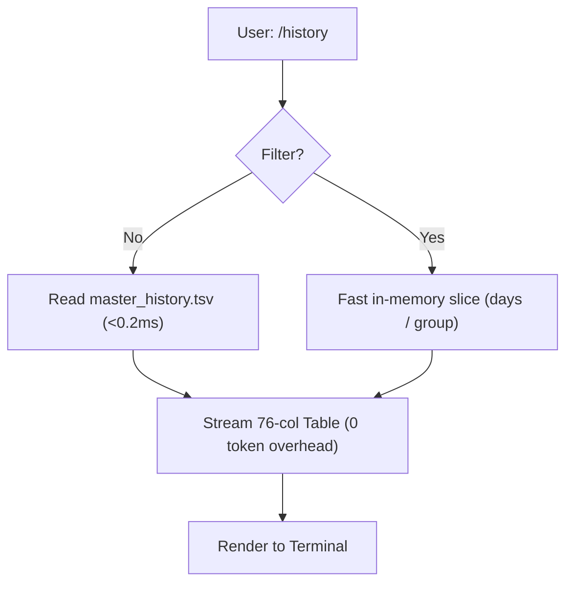
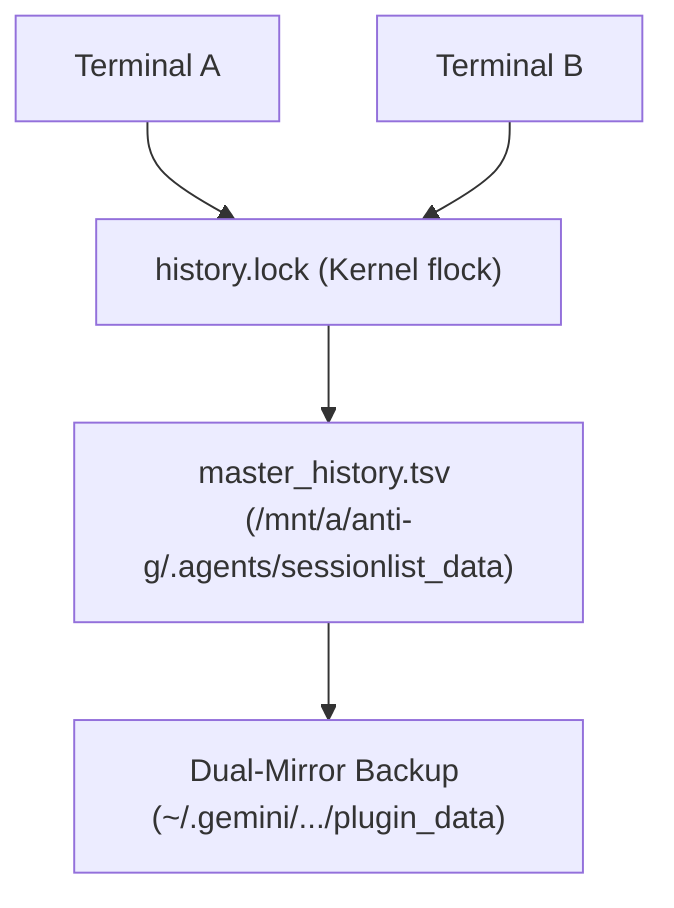

# Ach!

**Archive Chat History** — unified session manager for Antigravity. Command: `ach`

[](https://github.com/AshraArc/-antigravity-chat-manager/releases)
[](LICENSE)
[](#features)

`Ach!` provides SQLite FTS5 full-text search, 1-key interactive session resuming, batch maintenance, and in-chat conversational history recall.

---

## Highlights

- **Fast FTS5 Search**: Query complete conversation histories in under 4ms using SQLite WAL mode.
- **1-Key Resume**: Jump straight into active sessions without copying 36-character UUIDs.
- **Batch Cleanup**: Prune dead or test chats in bulk with ranges (`d 1-5`) or lists (`d 1,3,4`).
- **Markdown Export**: Export conversation transcripts to clean Markdown files in `exported_chats/`.
- **Zero-Token Fast Path**: In-chat `/history` streams pre-formatted 76-column tables with zero LLM generation latency.
- **Concurrency Safe**: Advisory locking (`flock`) prevents race conditions across multi-terminal setups.

---

## Installation

### 1-Line Quick Install

```bash
curl -fsSL https://raw.githubusercontent.com/AshraArc/-antigravity-chat-manager/main/get.sh | bash
```

Custom binary prefix (e.g. `ag` or `ach` instead of `antig`):
```bash
curl -fsSL https://raw.githubusercontent.com/AshraArc/-antigravity-chat-manager/main/get.sh | bash -s -- ag
```

This installs:
- `antig-h`: Fast non-interactive table dump (< 90ms).
- `antig-m`: Interactive terminal management dashboard.

### Antigravity In-Chat Plugin

To enable conversational session recall inside active Antigravity chats:

```bash
agy plugin install https://github.com/AshraArc/-antigravity-chat-manager
```

*Or install locally:* `agy plugin install /path/to/sessionList`

---

## Usage

### Terminal Commands

#### Quick Table Dump (`antig-h` / `ach`)

```bash
antig-h              # Show 15 most recent sessions
antig-h --all        # Show complete history archive
antig-h --days 7     # Filter sessions from past 7 days
antig-h --hours 2    # Filter sessions from past 2 hours
antig-h -s "query"   # Full-Text Search (FTS5) across titles and transcripts
antig-h -x all       # Batch export all conversations to markdown
antig-h rm 1-3       # Batch delete sessions 1 through 3
antig-h mv 1 /path   # Transplant session #1 to another workspace directory
```

#### Interactive Dashboard (`antig-m`)

Launch the keyboard-driven management interface:

```bash
antig-m
```

```text
Ach! v2.2.0
────────────────────────────────────────────────────────────
[1] Today 18:24  Investigate FTS5 full-text recall benchmark
[2] Today 15:10  Build sqlite wal query pipeline & flock mutex
[3] Yesterday    Add multi-workspace transcript sync
```

Navigation shortcuts:
- `<num>`: Resume selected session.
- `e <num>`: Edit chat title or update group label.
- `d <n1,n2..>`: Delete one or multiple sessions (e.g. `d 1,3,4` or `d 1-3`).
- `n`: Launch a brand-new Antigravity session.
- `Esc` / `b`: Return to previous menu or cancel.

---

### In-Chat Natural Language Commands

In any active Antigravity chat, trigger session history naturally:

| Goal | Example Prompt |
| :--- | :--- |
| **Recent sessions** | `/history` or `show my chat history` |
| **Full archive** | `show me all chat histories` |
| **Time filter** | `history of past 7 days` or `past 2 hours` |
| **Search transcripts** | `search history for sqlite fts5` |
| **Notebook groups** | `show my notebook groups` |

---

## Architecture

### Fast-Path In-Chat Query Flow


### Multi-Terminal Concurrency & Storage


---

## Directory Structure

```text
sessionList/
├── sessionlist.py              # Core engine: SQLite FTS5 index, TUI, flock locking
├── install.sh                  # Installer script
├── plugin.json                 # Antigravity plugin manifest
├── README.md                   # Documentation & usage reference
└── skills/
    └── sessionlist/
        └── SKILL.md            # In-chat agent skill definition
```

Runtime storage paths:
- `.agents/sessionlist_data/master_history.tsv`: Fast-path session catalog cache.
- `.agents/sessionlist_data/history.lock`: Kernel mutex lock for safe concurrent writes.
- `.agents/exported_chats/`: Destination for Markdown transcripts (`*.md`).
- `~/.local/bin/`: User launchers (`antig-h`, `antig-m`).

---

## Uninstall

```bash
curl -fsSL https://raw.githubusercontent.com/AshraArc/-antigravity-chat-manager/main/uninstall.sh | bash
```

Or run `./uninstall.sh` from the repository root.

---

## License

[MIT](LICENSE) © [AshraArc](https://github.com/AshraArc)
